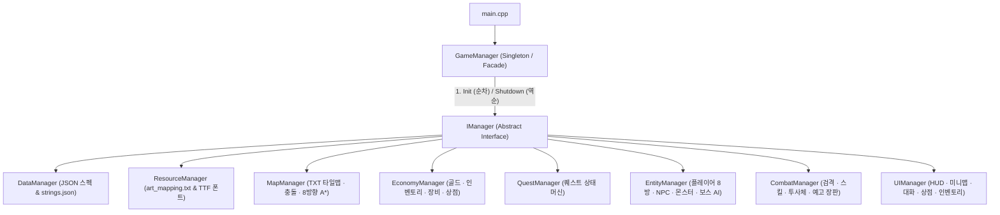

# 잿빛 왕관의 연대기 (Chronicle of the Ashen Crown)

C++17과 `raylib`(+ `nlohmann/json`)으로 제작된 **클라이언트 온리(Client-Only) 2D 탑뷰 타일맵 솔로 RPG**입니다.  
모든 게임 스펙·문자열·맵·아트 리소스를 외부 데이터 파일에서 동적으로 읽어 구동되는 완전 데이터 드리븐 구조로 설계되었습니다.

### 빠른 시작 (Windows + Visual Studio 2022)
```powershell
# Release 빌드 및 자동 검증(스모크 테스트)
powershell -ExecutionPolicy Bypass -File build.ps1 -SmokeTest

# Release 빌드 및 게임 실행
powershell -ExecutionPolicy Bypass -File build.ps1 -Run

# 이미 빌드된 실행 파일 직접 실행
.\build\Release\AshenCrownRPG.exe

# 기획자용 통합 툴 (데스크톱 UI / CLI)
powershell -ExecutionPolicy Bypass -File launch_designer_tool.ps1
python tools/designer_tool.py validate --json
```

---

## 1. 코드 (프로그래밍)

### 1.1 기술 스택 및 빌드 구성
* **언어 / 표준**: C++17 (MSVC x64, `/utf-8` UTF-8 소스 인코딩 강제)
* **렌더링 · 입력 · 윈도우**: `raylib 5.5` (CMake `FetchContent` 자동 연동)
* **JSON 파싱**: `nlohmann/json 3.11.3` (단일/헤더 온리)
* **빌드 시스템**: [CMakeLists.txt](CMakeLists.txt) + [build.ps1](build.ps1) (`POST_BUILD` 단계에서 `data/`와 `assets/`를 실행 파일 경로로 자동 동기화)

### 1.2 핵심 아키텍처: 싱글톤 통합 Manager + 추상 `IManager`
이 프로젝트는 **Singleton + Facade 패턴**을 결합한 단일 진입점 구조를 채택합니다.  
[src/main.cpp](src/main.cpp)는 오직 `GameManager::Get().Run()`만 호출하며, 모든 기능 모듈은 공통 추상 인터페이스 [IManager](src/core/IManager.h)를 구현해 [GameManager](src/core/GameManager.h) 내부에서 일관된 생명주기(`Init → Update → Render → Shutdown`)로 제어됩니다.



* **초기화 순서 보장**: `Data → Resource → Map → Economy → Quest → Entity → Combat → UI` 순서로 초기화하고 종료 시 역순으로 해제하여, 다중 싱글톤 사용 시 발생하는 초기화 순서 꼬임(Static Initialization Order Fiasco)과 순환 참조를 방지합니다.
* **책임 분리(SRP)**: 각 매니저는 자신의 도메인 데이터와 로직만 소유하며, 상호 참조가 필요할 때만 `GameManager::Get()`을 통해 안전하게 접근합니다.

### 1.3 주요 시스템 구현 방식

1. **100% 데이터 드리븐 로딩 & 자동 한글 폰트 글리프 수집**
   * [DataManager](src/managers/DataManager.cpp)가 `data/*.json`(플레이어·아이템·몬스터·보스·NPC·퀘스트·맵·타일·문자열 테이블)을 파싱하고, 소스 코드 내 하드코딩 문자열 없이 `GetText(key)` / `FormatText(key, args)`로 모든 UI·알림 문구를 제공합니다.
   * [ResourceManager](src/managers/ResourceManager.cpp)는 오직 [data/art_mapping.txt](data/art_mapping.txt)(`ArtID ↔ RelativePath`)만 읽어 `std::unordered_map<int, Texture2D>`에 `TEXTURE_FILTER_POINT`로 캐싱합니다.
   * `LoadUIFont()`는 `data/strings.json`의 폰트 설정과 모든 로드된 JSON 파일에서 고유 UTF-8 코드포인트를 **자동 추출**해 `LoadFontEx`에 전달하므로, 데이터에 한글을 추가해도 글리프 누락 없이 선명하게 렌더링됩니다.
2. **8방향 이동 · 충돌 슬라이딩 · 방향별 애니메이션**
   * [Types.h](src/core/Types.h)의 `Direction8`(`0:S, 1:SW, 2:W, 3:NW, 4:N, 5:NE, 6:E, 7:SE`)과 정규화 벡터($1/\sqrt{2}$)로 8방향 동일 속도를 구현했습니다.
   * [EntityManager](src/managers/EntityManager.cpp)의 `MoveEntityWithCollision()`은 X축과 Y축 충돌을 분리 검사해 벽면을 부드럽게 슬라이딩하며, 렌더링 시 스프라이트 시트의 `Row = Direction8`, `Col = animFrame`으로 8방향 `Idle / Walk / Attack` 애니메이션을 재생합니다.
   * 모든 엔티티(플레이어·NPC·몬스터·보스)는 매 프레임 Y좌표 기준 정렬(Y-Sorting) 후 렌더링되어 탑뷰 원근감을 유지합니다.
3. **8방향 타일 기반 A\* 길찾기 (몬스터 & 보스 AI)**
   * [MapManager::FindPath](src/managers/MapManager.cpp)에 정수 비용(직교 `10`, 대각선 `14`)과 **Octile 휴리스틱** 기반 8방향 A\*를 구현했습니다.
   * 대각선 이동 시 인접 직교 타일 2칸이 모두 통행 가능해야 통과하도록 **코너 끼임 방지**를 적용했고, 보스처럼 반경이 큰 개체(`radius = 26px`)는 `IsCircleWalkable` 여유 반경(Clearance) 탐색 후 필요 시 단일 타일 경로로 폴백합니다.
   * 몬스터와 보스 AI는 매 프레임 탐색 대신 **약 `0.25초` 주기(ID별 분산 오프셋)**로 경로를 캐싱·재탐색(Repath Throttling)하여 프레임 저하 없이 다리·기둥을 우회합니다.
4. **전투 · 퀘스트 · 경제 · UI & 자동 스모크 테스트**
   * [CombatManager](src/managers/CombatManager.cpp): 8방향 전방 부채꼴 검격, 360° 회오리 베기 스킬, 무적 대시, 넉백, 투사체, 보스 2페이즈 패턴(광폭화·방사형 탄막·예고 원형 장판·고속 돌진) 처리.
   * [QuestManager](src/managers/QuestManager.cpp) / [EconomyManager](src/managers/EconomyManager.cpp) / [UIManager](src/managers/UIManager.cpp): 퀘스트 상태 머신(`NotStarted → Active → ReadyToTurnIn → Completed`), 골드/장비 스탯 합산, 상점·인벤토리·대화창·미니맵·보스 체력바 구현.
   * `AshenCrownRPG.exe --smoke-test`: 숨김 윈도우로 전체 JSON(99개 문자열 포함)·39개 PNG 텍스처·3종 타일맵·A\* 강 다리/보스 기둥 우회·8방향·상점·퀘스트·렌더 루프를 자동 검증합니다.
5. **기획자용 통합 툴 (UI + CLI 공용 코어 아키텍처)**
   * [tools/designer_core.py](tools/designer_core.py)에 모든 비즈니스 로직(맵 편집·아트 업로드·아트 요구사항 큐·JSON 파싱/검색/편집·교차 무결성 검증)을 분리하고, 데스크톱 GUI([tools/designer_ui.py](tools/designer_ui.py), `tkinter + PIL.ImageTk`)와 CLI([tools/designer_tool.py](tools/designer_tool.py), `--json` 출력 지원)가 동일한 코어를 호출하도록 설계했습니다. 전체 기능 목록은 [docs/designer_tool_cli.md](docs/designer_tool_cli.md)에 정의되어 있습니다.

### 1.4 프로젝트 디렉토리 구조
```text
├── AGENTS.md                 # Antigravity 상시 프로젝트 컨텍스트 및 규칙
├── CMakeLists.txt / build.ps1 # CMake 빌드 설정 및 Windows 자동 빌드 스크립트
├── launch_designer_tool.ps1  # 기획자용 통합 툴(UI/CLI) 원클릭 실행 스크립트
├── docs/                     # 기획 문서 (game_design.md, tile_design.md, art_resources.md, designer_tool_cli.md)
├── data/                     # JSON 스펙(9종), strings.json, art_requests.json, art_mapping.txt, maps/*.txt(3종)
├── assets/                   # PNG 아트 리소스 39종 (tiles, characters, monsters, boss, npcs, items, effects)
├── tools/                    # generate_art.py + 기획자용 툴 (designer_core.py, designer_ui.py, designer_tool.py)
└── src/
    ├── main.cpp              # 단일 진입점 (GameManager::Get().Run)
    ├── core/                 # Types.h, IManager.h, GameManager.h/.cpp
    └── managers/             # 8개 IManager 구현체 (Data, Resource, Map, Economy, Quest, Entity, Combat, UI)
```

---

## 2. 기획

상세 명세는 [종합 게임 기획 문서](docs/game_design.md) 및 [타일·맵 설계 문서](docs/tile_design.md)에 정리되어 있습니다.

### 2.1 세계관 및 코어 게임 루프
어둠에 잠식된 **잿빛 군주 말라코르**가 고대 성채 알현실을 점령한 세계에서, 방랑 기사 아론이 **마을(정비) → 필드(전투·성장) → 보스 룸(보스 토벌)** 루프를 거쳐 잿빛 왕관을 되찾는 솔로 액션 RPG입니다.

### 2.2 조작키 및 플레이어 성장 (`data/player.json`)
* **이동**: `WASD` / 방향키 (8방향 이동)
* **전투**: `J` / `Space` / 좌클릭(기본 검격), `K` / 우클릭(회오리 베기), `Left Shift`(회피 대시)
* **상호작용 / UI**: `E`(NPC 대화·상점·치유), `1`/`2`(체력/상급 포션), `I`(인벤토리·장비), `Q`(퀘스트 일지), `ESC`(창 닫기)
* **성장**: 최대 Lv.10, 레벨업 시 최대 HP·공격력·방어력 상승 및 체력 완전 회복.

### 2.3 맵 구성 및 타일 데이터 규칙 (`data/maps.json`, `data/maps/*.txt`)
| 맵 ID | 지역명 | 크기 | 역할 및 주요 요소 |
| :--- | :--- | :---: | :--- |
| `town` | 에쉬우드 마을 | `24×18` | 안전지대, NPC 3명(촌장 엘드릭·상인 마라·치유사 세라), 치유의 분수, 동쪽 필드행 포탈 |
| `field` | 저주받은 황야 | `32×24` | 전투지대, 강과 나무 다리 2개, 슬라임·고블린·해골 리스폰, 서쪽 마을 포탈 & 북쪽 보스 포탈 |
| `boss_room` | 잿빛 성채 알현실 | `24×18` | 보스 아레나, 흑요석 기둥 4개 & 외곽 용암, 보스 '잿빛 군주 말라코르', 남쪽 퇴각 포탈 |

* **TXT 타일맵 규격**: `#` 주석 무시, Y행(위→아래) × X열(좌→우) 공백 구분 2자리 정수 타일 ID(`00`~`15`) 나열.

### 2.4 오브젝트 · 퀘스트 · 경제 시스템
* **NPC (`data/npcs.json`)**: 촌장 엘드릭(메인 퀘스트 3종), 상인 마라(포션·무기·방어구 상점), 치유사 세라(무료 100% 회복).
* **필드 몬스터 (`data/monsters.json`)**: 잿빛 슬라임(근접), 고블린 약탈자(고속 추적), 해골 파수꾼(근접 + 원거리 투사체).
* **보스 몬스터 (`data/bosses.json`)**: **잿빛 군주 말라코르** — 1페이즈(근접 참격 · 8방향 화염 탄막 · 예고 장판) / HP 50% 이하 2페이즈 광폭화(이동속도 상승 · 12방향 회전 탄막 · 3연쇄 장판 · 예고 고속 돌진).
* **퀘스트 체인 (`data/quests.json`)**: `마을 외곽 정화`(슬라임 4) → `황야의 약탈자 소탕`(고블린 3 + 해골 2, 보상 강철 장검) → `잿빛 군주 토벌`(말라코르 격파, 보상 잿빛 왕관 & 엔딩).
* **아이템 & 재화 (`data/items.json`)**: 소비 아이템 2종, 무기 3티어(철제 단검 → 강철 장검 → 룬의 성검), 방어구 3티어(가죽 → 판금 → 잿빛 수호갑옷), 퀘스트 아이템 1종(잿빛 왕관).

### 2.5 기획자용 툴 지원 기능 (UI & CLI 동시 지원)
* **맵 제작 및 수정**: PNG 타일 팔레트 기반 브러시·Flood Fill·크기 조절·신규 맵 생성(`data/maps/*.txt` + `maps.json` 동기화).
* **기획 문서(JSON) 편집 및 검색**: 9종 기획 JSON을 파싱해 구조화 폼 UI로 표시하고, 단일 문서 및 전체 문서 통합 검색·추가·복제·삭제·교차 참조 검증 지원.
* 상세 기능 및 CLI 명령 목록: [docs/designer_tool_cli.md](docs/designer_tool_cli.md)

---

## 3. 아트

전체 리소스 목록·프레임 규격·아트 컨셉은 [아트 리소스 명세서](docs/art_resources.md)에 정의되어 있습니다.

### 3.1 아트 컨셉 및 리소스 매핑 체계
* **비주얼 스타일**: 중세 다크 판타지 2D 픽셀아트 (마을의 따뜻한 석재·녹지, 필드의 황야·강·폐허, 보스 룸의 흑요석·진홍 카펫·용암 대비).
* **번호-경로 매핑 분리**: 모든 리소스는 고유 정수 ID와 상대 경로가 기록된 [data/art_mapping.txt](data/art_mapping.txt)로 관리되며, 게임 로직은 파일 경로를 직접 하드코딩하지 않고 Art ID만으로 텍스처를 조회합니다.

### 3.2 리소스 대역 및 규격 요약 (총 39종 PNG)
| Art ID 대역 | 카테고리 | 수량 | 규격 / 프레임 구조 | 저장 경로 |
| :---: | :--- | :---: | :--- | :--- |
| `1 ~ 16` | 지형 타일 (초원·흙길·석재·성채·카펫·다리·나무·건물·성벽·물·용암·꽃·분수·포탈) | 16 | `32×32` 단일 타일 | `assets/tiles/` |
| `101 ~ 103` | 플레이어 기사 (`Idle`, `Walk`, `Attack`) | 3 | `192×384` (`48×48` × 4프레임 × **8방향 행**) | `assets/characters/` |
| `201 ~ 203` | 필드 몬스터 (슬라임·고블린·해골) | 3 | `160×40` (`40×40` × 4프레임) | `assets/monsters/` |
| `301` | 보스 '잿빛 군주 말라코르' | 1 | `320×160` (`80×80` × 4프레임 × 2행: 1페이즈/광폭화) | `assets/boss/` |
| `401 ~ 403` | 마을 NPC (촌장·상인·치유사) | 3 | `160×40` (`40×40` × 4프레임) | `assets/npcs/` |
| `501 ~ 509` | 아이템 아이콘 (포션·무기·방어구·잿빛 왕관) | 9 | `32×32` 아이콘 | `assets/items/` |
| `601 ~ 604` | 전투 이펙트 & UI (참격·회오리·화염구·금화) | 4 | `128×32` (4프레임) / `32×32` | `assets/effects/` |

### 3.3 플레이어 8방향 스프라이트 시트 행(Row) 규격
| Row | `0` | `1` | `2` | `3` | `4` | `5` | `6` | `7` |
| :---: | :---: | :---: | :---: | :---: | :---: | :---: | :---: | :---: |
| **방향** | 하 (S) | 좌하 (SW) | 좌 (W) | 좌상 (NW) | 상 (N) | 우상 (NE) | 우 (E) | 우하 (SE) |

### 3.4 아트 에셋 생성 · 업로드 · 요구사항 큐 파이프라인
* **일괄 픽셀아트 생성**: [tools/generate_art.py](tools/generate_art.py)가 [data/art_mapping.txt](data/art_mapping.txt)를 파싱해 39종 PNG 에셋을 일괄 생성합니다.
* **아트 업로드 & 자동 매핑**: 기획자용 툴(`art upload` / UI 탭 2)로 외부 이미지를 업로드하면 PNG 변환·리사이즈 후 `assets/` 배치, `data/art_mapping.txt` 등록, `docs/art_resources.md` 기록까지 자동 갱신됩니다.
* **아트 요구사항 기록 (LLM 연동 준비)**: 아직 제작되지 않은 리소스의 짧은 설명·규격·카테고리를 `pending` 상태로 [data/art_requests.json](data/art_requests.json)에 저장(`art-req add` / UI 탭 3)해 두면, 차후 LLM이 `art-req list --status pending --json`으로 대기 목록을 조회해 이미지 생성 모델을 호출하고 업로드·완료 처리까지 자동화할 수 있습니다.
